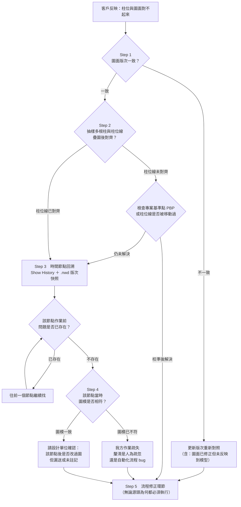

# 模型驗收與根因分析流程

## 情境

客戶收到 3D 模型後反映：「這根柱子的位置好像跟圖面對不起來。」

需要一套驗收流程，讓客戶能自己對照原始 2D 平立面確認 3D 模型的幾何位置是否正確，並在確實有偏差時判斷是哪個環節出錯。

**前提假設**：本文假設客戶不等於 2D 圖面的提供者，可能是另外委託的設計單位，或是公司內部設計部門，以下統一稱為「設計單位」。這個假設影響了後續流程中「誰負責確認圖面版次」的責任歸屬。

---

## 核心思路：先版次溯源，不要急著疊圖

本流程的核心不是「立即疊圖比對」，而是先從管理層面的**版次溯源（Revision Tracing）**切入。

理由是實際發生率：**過去經驗中，超過半數的「模型錯位」申訴最終都是圖面版次不一致造成的**。因為 BIM 模型往往是「先有 2D 再有 3D」，版次錯誤是最常見、且最低成本即可排除的原因。

一上來就做技術比對，最常見的結局是花了大把時間，最後發現只是客戶拿錯圖。

---

## 工具與方法

| 工具 | 操作方式 | 為什麼選它 |
|---|---|---|
| **Revit Link CAD** | 將原始 2D DWG 以 Link 形式置入 Revit，直接在平面視圖目視比對柱位 | 不需匯出任何檔案，Revit 內建功能，可精確到 mm 級別的疊圖比對 |
| **Collaborate > Show History** | 查看 Workshared 檔案的 Sync with Central 歷程，定位問題發生的時間節點 | Revit 內建功能，可看到誰在什麼時候存了什麼，配合時間節點回溯使用 |
| **.nwd 版次留存** | 每次正式交付時由 Revit 轉出 .nwc 再轉 .nwd，作為該版次的模型快照 | .nwd 是自包含格式，客戶用免費的 Navisworks Freedom 即可開啟，不需 Revit License，且為唯讀不可竄改，可作為中立證據檔案 |

### 為什麼要多一道 .nwc → .nwd

這一步並非多餘。**.nwc 需要對應版本的 Navisworks 才能開啟，而 .nwd 是自包含格式（Self-contained）**，確保客戶端不會因為軟體版本問題而打不開。

這套機制的真正價值在治理層面：它讓「驗收爭議」從**各說各話**變成**大家開同一個 .nwd 來看**，把模型版本從 Revit 的封閉生態解放出來，變成一個中立的證據檔案。

---

## 決策樹

---

## 各階段細節

### Step 1. 版次確認（Revision Verification）

先確認客戶手上的圖面版次與日期，與我方建模時依據的圖面版次是否一致。

- **版次不一致** → 直接更新版次重新對照即可。版次錯誤包含「圖面已修正但未送過來反映到模型上」的情況。
- **版次正確** → 進入 Step 2。

### Step 2. 抽樣比對（Sampling Comparison）

客戶提到「這根柱子」，但問題可能不限於單一柱位。因此先多抽樣幾根柱子及柱位線，透過 Revit Link CAD 疊圖確認是否對齊。

- **柱位線未對齊** → 先確認專案基準點（Project Base Point, PBP）或柱位線本身是否被移動過。校準後若問題解決則到此為止；若仍未解決則進入 Step 3。
- **柱位線已對齊** → 直接進入 Step 3。

抽樣的目的是分辨「**整體偏移**」與「**個別錯誤**」—— 前者通常是基準點問題，一次修正就全好；後者是建模品質問題，得逐一查。

### Step 3. 問題時間點搜尋（Timeline Investigation）

透過 Revit 的 Collaborate > Show History 讀取 Workshared 檔案的 Sync with Central 歷程，檢視過去修改柱位相關檔案（可能是 AR 或 SE）的時間節點。

配合每次正式交付時留存的 .nwd 檔案，可以直接開啟該版次的模型快照進行比對，**不需要透過 Restore Backup 重新載入舊版 .rvt 檔**。

回溯邏輯：

- 對照該節點作業開始前的圖模狀況是否一致、問題是否已存在
- 若問題仍存在 → 繼續往前一個節點找
- 若問題不在 → 問題即發生在該時間節點，進入 Step 4

### Step 4. 作業確認（Operation Verification）

確認該時間節點進行了什麼作業，當下的圖面版次與模型有無差異。

- **當時圖模已不符** → 為我方作業的疏失，進入檢討階段，釐清是建模時的人為疏忽還是自動化流程的 bug。
- **當時圖模一致** → 請設計單位協助確認他們手上圖面的版次，是否在該時間節點到最新版本之間改過圖檔但忘了送出，或是修了但沒特別提到（例如建物面積很大，但改動在圖面小角落又沒註記或畫雲形標示）。

### Step 5. 流程修正（Process Improvement）

**無論問題源頭為何，最終都應進入流程修正環節**，確認以下事項：

- 作業時間節點有無留存（Sync with Central 的 comment、.nwd 快照）
- 與客戶／設計單位的需求是否明確並有通訊紀錄
- 圖面版次控管機制是否完善（建議推行 Drawing Issue Register 圖面發行登記表）

若流程紀錄都已齊全，則問題在於提升模型品質本身：

- **人力建模** → 提升工程師的細心程度、強化自檢流程
- **自動化建模** → 反而好處理，就是標準的抓出 bug 發生原因的流程

---

## 排查順序的設計理念

整個流程依照「**成本由低到高**」的原則設計：

| 順序 | 檢查項目 | 為什麼擺這個順序 |
|---|---|---|
| ① | 圖面版次 | 最常見、最低成本，10 秒即可確認。超過半數的爭議在這步就解決了 |
| ② | 柱位線對齊 | 比單一柱子更能看出是「整體偏移」還是「個別錯誤」 |
| ③ | 基準點（PBP） | 若柱位線整體偏移，通常是 PBP 被移動過，校準後可能直接解決 |
| ④ | 時間節點回溯 | 透過 Show History ＋ .nwd 快照做時間點回溯，定位問題首次出現的節點 |
| ⑤ | 圖模狀態比對 | 確認該節點當時的圖面與模型是否一致，分流我方疏失 vs 設計端漏送 |
| ⑥ | 流程紀錄審查 | 前五項都排除後，審視 SOP 本身是否完善，作為預防未來問題的改善點 |

先快速排除最常見的「人為版本管理失誤」，再逐步進入需要較多時間與技術力的「建模品質審查」。
