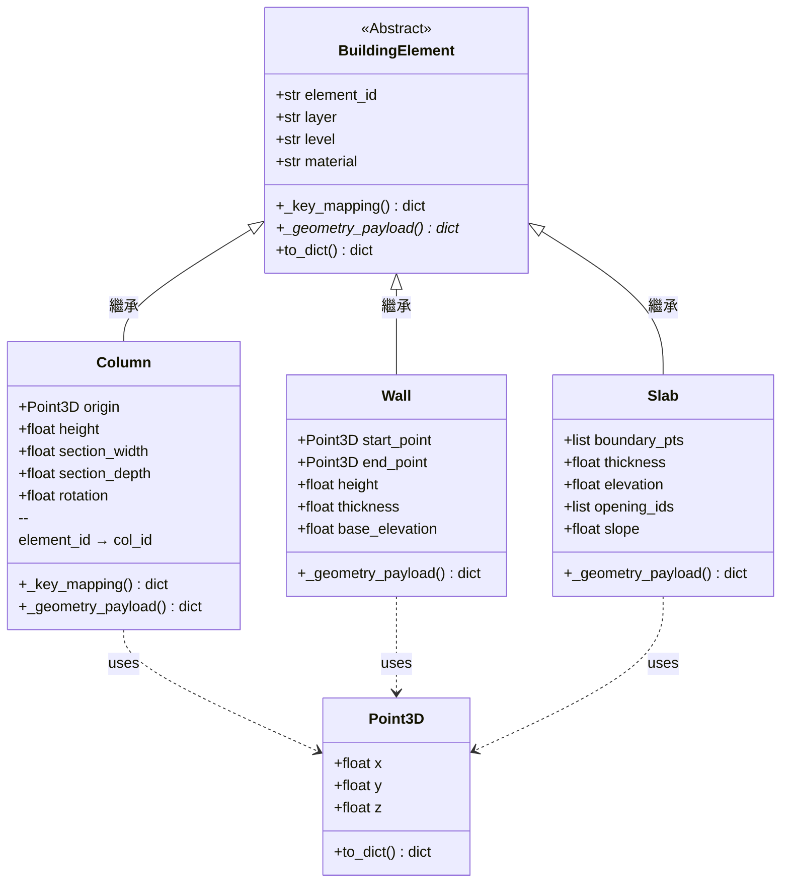

# 建築構件資料結構

## 情境

系統需要將 CAD 圖面中解析出的建築構件，組裝成結構化資料後傳遞給下游的 3D 生成模組。不同構件（如 Column、Wall、Slab）都有共用屬性與各自的幾何資訊，最終要能生成 JSON 格式輸出。

可執行實作見 [`building_elements.py`](../building_elements.py)。

---

## 設計前提假設

本架構假設 CAD 圖面已完成以下前處理：

- 各構件以獨立圖塊（BLOCK）或帶有自定義屬性的實體表示，而非分解的線條或點元素
- 圖塊插入點已對齊座標系原點（可透過 AutoLISP 工具批次校正，如 LeeMac 的 Change Block Base Point，或於讀取時以原點偏移量補正）
- 圖面原點座標已與 3D 模型座標系對齊
- 構件類型依圖層命名規則識別，各構件類型使用獨立圖層，避免混用預設圖層（如圖層 0）

此外，本架構以理想化構件為前提，略去以下平台差異細節：Slab 對應 Revit 中的 Floor 類別；Column 在 Revit 中進一步區分為結構柱（Structural Column）與建築柱（Architectural Column）。實際對接時，子類別命名與 JSON key 可依目標平台規格調整。

> 以下參數僅為示意，目的在表達架構的共用性、可擴充性、預設值與 key mapping 的設計概念。實際實作時，幾何參數的數量與型別會依圖面規範、座標系定義及下游模組接收格式而有所不同。構件識別、圖層解析、異常處理等前處理邏輯均未納入本範疇（見 [03 資料提取](03-cad-vs-revit-extraction.md)）。

---

## 類別架構

---

## 架構選擇的理由

### ① 單一職責原則（Single Responsibility Principle）

共用屬性集中在父類別管理；各構件的幾何邏輯只在自己的子類別內定義，兩者職責不混用。修改其中一方不會連動另一方。

### ② 開放封閉原則（Open/Closed Principle）

日後新增構件類型（如 Beam、Door）只需新增子類別，不需修改父類別或既有子類別的任何程式碼。架構對擴充開放、對修改封閉。

### ③ 強制契約（Abstract Method）

父類別的 `_geometry_payload()` 宣告為抽象方法，強制每個子類別都必須實作自己的幾何輸出邏輯。未實作則在執行前就會報錯，不會等到輸出時才發現問題。

### ④ 解耦：資料內容與輸出格式分層

`_key_mapping()` 的存在，將「資料內容（屬性值）」與「輸出欄位命名（JSON key）」分成兩層：

| 層次 | 說明 | 穩定性 |
|---|---|---|
| 資料層（屬性值） | element_id、layer 等實際資料 | 穩定，不隨下游需求變動 |
| 命名層（JSON key） | 輸出時貼上的標籤名稱 | 易變，各下游模組可能要求不同命名 |

這一層分離是整個架構最實用的部分 —— 下游模組的命名要求變動頻率遠高於資料本身的結構變動。

---

## 驗證：下游要求 Column 的 key 改名時，要動哪裡

當下游模組要求 Column 的 `element_id` 改輸出為 `col_id`，而 Wall 與 Slab 不受影響時：

- 只需在 `Column` 子類別內覆寫 `_key_mapping()` 方法
- 將其中 `"element_id"` 的輸出標籤改為 `"col_id"`
- `Wall` 與 `Slab` 未覆寫此方法，繼續沿用父類別預設值，**零異動**
- 父類別的 `to_dict()` 邏輯**一行未動**

改動範圍嚴格限制在 `Column` 子類別的單一方法內。這正是 `_key_mapping()` 設計為可覆寫的核心理由：**讓格式需求的變動不會擴散到整體架構**。
